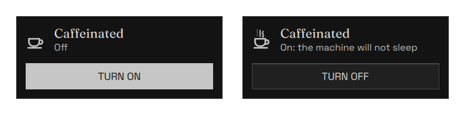
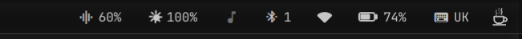
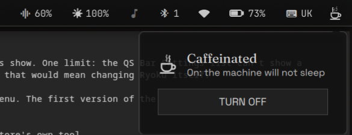

# Caffeinated

Caffeine for the whole machine. A coffee cup on the QS Bar: plain when off,
steaming when on. Click it, then **TURN ON** or **TURN OFF**. That is the whole
panel; everything else is set once under QS Bar Settings > Community.




On a live QS Bar, at the right end:





## Modes

| Mode | Idle dim / lock / screen-off | Idle suspend | Lid close |
| --- | --- | --- | --- |
| **Stay unlocked** (default) | blocked: screen stays on, unlocked | blocked | locks, does not suspend |
| **Lock + run** | run as usual | blocked | locks, does not suspend |
| Off | normal | normal | normal |

Closing the lid always locks: that is Ryoku's lid policy, and Caffeinated
only stops the sleep that follows. In Lock + run mode, *Lock the screen when
enabling* (off by default) also locks right after **TURN ON**.


## How it works

Enabling starts `systemd-inhibit --mode=block` with `sleep:handle-lid-switch`
(plus `idle` in Stay unlocked) as a detached process, so it survives a shell
reload. logind rejects a plain suspend request while a strong block inhibitor is
held, so both the idle-timeout suspend and Ryoku's lid-close suspend
(`ryoku-clamshell` → `ryoku-shell suspend`) stay off. Their lock step still
runs first, so a closed lid still locks. Opening the lid, or disabling, lets a
pending lid-close suspend go ahead.

The inhibitor releases itself, and the panel says why, when:

- the battery is discharging at or below *Turn off on battery at or below %*
  (default 15%, checked every 15 s even if the shell is down). This leaves room
  for the normal low-battery action, which a strong inhibitor would otherwise
  block;
- the login session ends;
- the plugin has been disabled or removed for 2 minutes (a shell reload
  re-attaches within seconds and keeps it);
- you click **TURN OFF**.

After a reboot it starts off.

## What it runs, reads and writes

- **Runs** `bin/caffeinated`, which calls `systemd-inhibit`, `setsid`, `flock`,
  `loginctl` and `ryoku-shell lock`, always with argv arrays.
- **Reads** `/sys/class/power_supply/*` (battery level and AC), `/proc/<pid>`
  of its own inhibitor, and its own login session's state.
- **Writes** only under `$XDG_STATE_HOME/ryoku/plugins/caffeinated/`: the
  inhibitor pid, mode, floor, shell attach/detach marks, and the last release
  reason.
- **No** network access, no privileged commands, no `pkexec`.

## Settings

| key | type | default | description |
| --- | --- | --- | --- |
| mode | choice | `awake` | `awake`: stay on and unlocked. `lock`: lock as usual, never suspend |
| lockOnEnable | toggle | false | lock the screen when enabling in lock mode |
| batteryFloor | int 0–50 | 15 | turn off on battery at or below this %; 0 = never |
| poll | int 2–120 | 10 | status refresh, seconds |

## Install

```
ryoku plugin validate .
ryoku plugin add . --bar --yes
```

It shows on the bar and under **QS Bar Settings > Community**.

## Author

Madhav Khosla <madhav.khoslaa@gmail.com>. This is a community plugin
(`official` is false).
