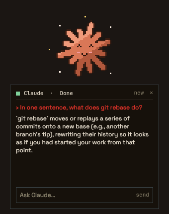
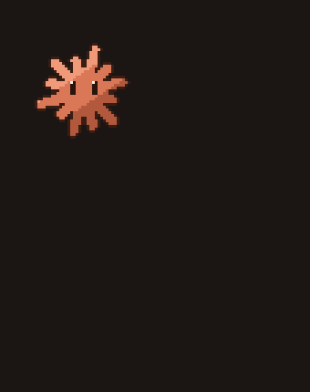
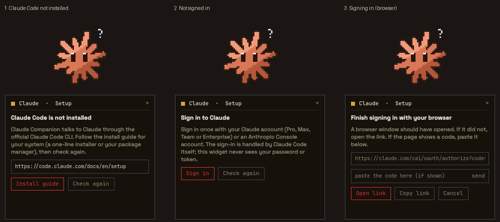
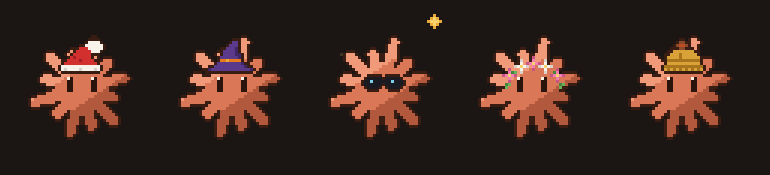

# Claude Companion

A small pixel-art spark that lives on your desktop wallpaper, mirrors what
[Claude Code](https://code.claude.com) is doing, and opens a compact chat when you
click it. If Claude Code is not installed or you are not signed in yet, it walks you
through both.





*Click the spark, ask a question, watch it think, get the answer. Recorded from the
plugin's own QML and scripts running in an isolated Quickshell window (no real desktop
in the frame); the answer is a real `claude -p` response.*

> **Unofficial.** Claude Companion is a community plugin. It is not made, endorsed or
> reviewed by Anthropic. "Claude" and "Claude Code" are Anthropic's names; the spark is
> an original drawing, not Anthropic's logo.

It is a [Ryoku](https://ryoku.sh) desktop-widget plugin (Quickshell on Hyprland): QML plus
four small bash scripts. No resident app, no compiled code, no account of its own.

## What it does

- **Shows what Claude is doing.** One spark, nine animations: sleeping, waking up,
  thinking, working (while a tool runs), waiting for you, done, error, needs attention,
  idle. It follows every Claude Code session you have running, in any terminal or editor.
- **Chats.** Click it for a small panel; ask something and the answer streams in. The
  conversation survives closing the panel and restarting the shell. *new* starts over.
- **Sets itself up.** First time here? It checks for Claude Code, points you to the
  install guide, and signs you in without leaving the widget. See [First run](#first-run).
- **Dresses for the season.** Christmas, Halloween, summer, spring and autumn outfits,
  each with its own falling or flying details. Off by default; *Auto* follows the
  calendar.

## Requirements

| What | Why |
| --- | --- |
| [Ryoku](https://ryoku.sh) (Hyprland + Quickshell) | the widget host |
| `claude` (Claude Code CLI) | does all the talking to Claude; the widget guides you to install it |
| `jq`, `inotify-tools` (`inotifywait`) | read the CLI's JSON output; watch session files without polling |
| A Claude plan with Claude Code access (Pro, Max, Team, Enterprise) or an Anthropic Console account | needed to sign in; the free claude.ai plan does not include Claude Code |

## Install

From Ryostore, once listed: open **Ryoku Hub > Plugins** and install *Claude Companion*.
From this repository, anytime:

```
ryoku plugin add https://github.com/AdriLabTech/claude-companion --yes
```

Then enable it and drag it where you want it. The host remembers the position per
monitor (Ctrl + wheel or the corner handle resizes it). Remove it with
`ryoku plugin remove claude-companion`.

## First run

Nothing to configure. The widget checks on start and tells you what is missing; the spark
shows a **?** while it needs you.



| You see | It means | What to do |
| --- | --- | --- |
| **Claude Code is not installed** | no `claude` command was found | *Install guide* opens the official instructions; install, then *Check again*. |
| **One helper tool is missing** | `jq` is not installed | Install it with your package manager, then *Check again*. |
| **Sign in to Claude** | Claude Code is installed but has no account | *Sign in*: your browser opens the official Claude page. |
| **Finish signing in** | the browser step is running | Approve in the browser. If the page shows a code instead of finishing by itself, paste it in the field and press *send*. *Open link* / *Copy link* are there if no browser opened. |

Sign-in is done by `claude auth login`, the official command. The widget only shows its
link and forwards a pasted code to it; **it never sees your password or token**, and the
tokens are stored by Claude Code in its own config directory, not by the plugin. If you
use an Anthropic Console account instead of a Claude plan, set *Sign-in account type* in
the settings first. If your login later expires, the next question brings you back to
the sign-in screen instead of failing silently.

More detail, including how to test every setup state on a machine that is already
signed in, in [docs/first-run.md](docs/first-run.md).

## Using it

| Do | Result |
| --- | --- |
| Click the spark | opens or closes the chat panel and wakes the spark up |
| Type, `Enter` | sends the message; *stop* cancels the turn (and the model call) |
| `Esc` | closes the panel |
| *new* | forgets the conversation and starts a fresh one |

What the spark means:

| State | When |
| --- | --- |
| Sleeping (zzz) | nothing happened for a while; any activity wakes it |
| Idle | awake and calm; blinks, looks around |
| Thinking (dots) | Claude is composing an answer |
| Working (sparks) | Claude is running a tool (Bash, Read, Edit...) |
| Waiting for you (?) | a session waits for input, or setup needs you |
| Needs attention (!) | a session is blocked on a permission prompt |
| Done | a turn finished: a short celebration |
| Error | a turn ended in an error, or the connection to Claude Code failed |

## Seasons



Set **Seasonal outfit** to *Auto* and it follows the calendar (pick the Northern or the
Southern hemisphere variant), or pin one. Christmas: Santa hat
and snow. Halloween: witch hat and bats. Summer: sunglasses, a small sun, glints.
Spring: flower crown, petals, a butterfly. Autumn: a beanie and falling leaves. Details
and dates in [docs/seasons.md](docs/seasons.md). *Reduced motion* turns the particles off
and holds the first frame of each animation; it also follows your desktop's reduced-animation
setting, read at start and after each setup check.

## How it plugs in

```
 ~/.claude/sessions + transcripts ─ companion-watch ─┐
                                                     ├─ ClaudeState ─ state machine ─ sprite
 claude -p (stream-json) ─ companion-chat ───────────┘
 companion-check / companion-login ── first-run setup ──┘
```

- `service/Main.qml`: all logic (setup, sign-in, merge of sources, state machine, chat).
- `content/Widget.qml`: the spark, the chat panel and the setup screens.
- `content/PixelSprite.qml`, `content/SeasonFx.qml`: sprite sheets and seasonal particles.
- `bin/gen-sprites.py`: draws every sheet and the generated `SpriteDefs.qml` /
  `SeasonDefs.qml` (needs python-pillow; not run by the plugin).

Docs: [first run](docs/first-run.md) · [seasons](docs/seasons.md) ·
[Claude integration](docs/claude-integration.md) · [character design](docs/character-design.md).

## Settings

Right-click the widget for the quick ones (the same list is under **QS Bar Settings >
Community**). Developers can also set `debugOverlay`, `debugState` (force an animation)
and `debugCycle` (step through all of them) in `~/.config/ryoku/plugins.json`; they are
kept out of the menu so it stays short.

| Setting | Default | What it does |
| --- | --- | --- |
| Pixel size of the companion | 3 | scale of the spark (1-8) |
| Fall asleep after idle | 120 s | when it starts sleeping |
| Reduced motion | off | static poses, no particles |
| Seasonal outfit | off | off, auto (northern or southern hemisphere), or one season |
| Claude Code activity | follow | *Off* disables the session watcher (chat only) |
| Chat working folder | *(empty)* | empty = a private state folder with no project files; set a folder to let Claude work on a project |
| Chat permissions | ask | `default` (tools needing approval are denied), `plan`, or `acceptEdits` |
| Sign-in account type | Claude account | or Anthropic Console (API billing) |

## What it runs, reads, writes and contacts

Written for the Ryoku plugin rules (R6 to R11); the same facts, in one place.

- **Runs** (all from `bin/`, never through a shell string built from your input):
  - `companion-check`: `claude --version`, `claude auth status`, `command -v jq`,
    `command -v inotifywait`, and `gsettings get ... enable-animations` if present.
    Prints one JSON line. The account email and organisation that `claude auth status`
    also prints are discarded before anything reaches the widget.
  - `companion-watch`: `inotifywait`, `jq`. Read-only.
  - `companion-chat`: `claude -p --output-format stream-json` with your message as one
    argument after `--`.
  - `companion-login`: `claude auth login`, only after you press *Sign in*.
- **Reads:** `~/.claude/sessions/*.json` and the tail of `~/.claude/projects/*/*.jsonl`
  (or `$CLAUDE_CONFIG_DIR`) to tell thinking from running a tool. It looks at status
  fields and the name of the running tool; it does not store or transmit transcript
  text. That folder layout is observed behaviour of Claude Code, not a documented API
  (see [docs/claude-integration.md](docs/claude-integration.md)).
- **Writes:** the plugin itself writes only `$XDG_STATE_HOME/ryoku/plugins/claude-companion/`
  (the id of your current chat, a few bytes) and temporary files; never `~/.claude`, never
  shell config. The `claude` processes it starts write their usual session data (and the
  credentials after sign-in) in Claude Code's own config directory, and with the
  `acceptEdits` permission they can edit files in the chat working folder.
- **Network:** none of its own. `claude` talks to `api.anthropic.com`; signing in involves
  `claude.ai` / `claude.com` / `platform.claude.com`; the install guide button opens
  `code.claude.com` in your browser. They are declared in `capabilities.network`.
- **No privileged commands.** No `sudo`, no `pkexec`.
- **Validator note.** `ryoku plugin validate` reports five `outside-write` *warnings*. They
  are false positives from the pattern `$HOME/...` appearing in scripts: the `PATH` line
  that makes `~/.local/bin/claude` findable (Quickshell often starts without your shell
  `PATH`) and reads of `~/.claude`. Nothing outside the state folder is written.

## Limits worth knowing

- The chat is headless: a tool that needs approval is denied and Claude says so. Pick
  `plan` or `acceptEdits` in the settings if you want something else.
- Success and error are inferred (Claude Code publishes no "outcome" event): a turn that
  ends after a failed tool can still read as success.
- The widget lives on the wallpaper layer, so windows cover it; opening the panel grows
  the tile downward, so keep the spark a panel's height above the screen edge.
- The host starts the service once per screen surface, so with two monitors you will see
  several `companion-watch` processes; each just blocks on inotify.

## Develop

```
claude-companion/
  manifest.json            # id, entry points, hosts, settings schema
  service/Main.qml         # main: setup, sign-in, state machine, chat
  content/Widget.qml       # content: spark, chat panel, setup screens
  content/PixelSprite.qml  # sprite-sheet player
  content/SeasonFx.qml     # seasonal particles
  content/*Defs.qml        # generated by bin/gen-sprites.py
  bin/companion-*          # check, login, chat, watch (bash)
  bin/gen-sprites.py       # draws every sheet (python-pillow)
  assets/                  # sheets, particles, preview-widget.png
  docs/                    # first run, seasons, integration, design, GIFs
```

Regenerate the art with `python3 bin/gen-sprites.py --preview /tmp/preview`.

## Credits

AdriLabTech <labs.lownoise@gmail.com>: community-made (`official` is false). MIT, see
[LICENSE](LICENSE).
