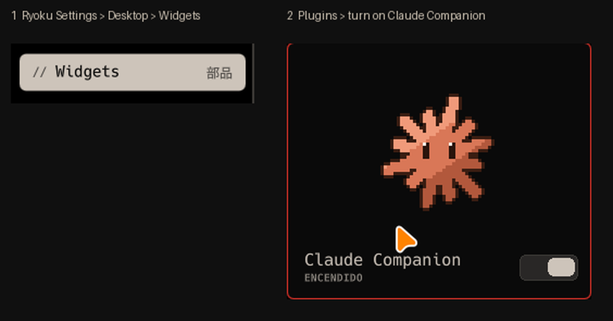
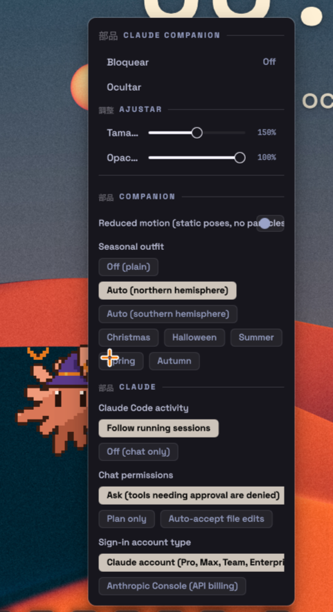

# Turn it on and choose the seasonal outfit

## 1. Put the widget on the desktop

Install it (see the README), then open **Ryoku Settings > Desktop > Widgets** (in Spanish:
*Ajustes Ryoku > Escritorio > Widgets*). Claude Companion is listed under **Plugins**; turn
its switch on and the spark appears on the wallpaper. The same page turns it off again.

From a terminal: `ryoku-shell hub open widgets` opens that page directly.

- **Move it:** drag the spark. The position is remembered per monitor.
- **Resize it:** Ctrl + mouse wheel over it, or drag the corner handle. The right-click menu
  also has size and opacity sliders.
- **Click it** to open the chat; click again (or press `Esc`) to close it.

The widget sits on the wallpaper layer, so open windows cover it. Show the desktop to see it.

## 2. Seasonal outfit

*Auto* is the default: the spark dresses for Christmas, Halloween, summer, spring or autumn
by the calendar and stays plain the rest of the year (see [seasons.md](seasons.md) for the
dates). To change it, **right-click the spark**: the menu lists the widget's settings, and
**Seasonal outfit** is a row of buttons:

| Button | Result |
| --- | --- |
| Off (plain) | never dresses up |
| Auto (northern hemisphere) | follows the calendar; the default |
| Auto (southern hemisphere) | same, with the seasons swapped |
| Christmas, Halloween, Summer, Spring, Autumn | pins that outfit all year |

The change applies at once, no restart.

To see all five outfits without waiting for the calendar, pin each one in turn from the menu.

## If something is off

- *The widget is not in the list:* check the install with `ryoku plugin list`, then reload
  the shell (`ryoku reload`).
- *It shows a "?" and a Setup panel:* Claude Code is not installed or you are not signed in;
  see [first-run.md](first-run.md).
- *It is invisible:* a window is covering it, or its opacity is at 0 in the right-click menu.
