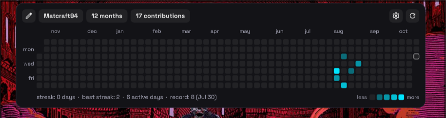

# GitLab Heatmap

Your GitLab contribution calendar, living on the wallpaper. One square per day,
coloured by how much you shipped, with streaks, records and a hover readout,
all styled to sit next to Ryoku's own desktop widgets.



## What it does

- **Your GitLab calendar, no token.** Reads the public
  `gitlab.com/users/<you>/calendar.json` endpoint; set your username and it
  just works.
- **Last 1–12 months.** GitLab only exposes the rolling year, so the widget
  always shows a window of recent months ending today (12 by default).
- **Quick styles.** One click for *Month blocks*, *Classic*, *Minimal* or
  *Full*, then fine-tune anything.
- **Eight palettes.** Theme (follows your wallpaper accent), Green, Blue,
  Purple, Pink, Orange, Ice and Mono.
- **Honest colour levels.** GitLab's endpoint returns raw counts, not levels,
  so days are bucketed into quartiles of your own distribution, or scaled
  relative to your best day — your choice.
- **Shape and spacing.** Rounded, square or circle cells; cell size and gap;
  months as one continuous grid or as separate blocks.
- **Labels your way.** Month names (`jan`, `Jan`, `J`, `1`), weekday labels
  (`mon wed fri`, all, or initials), week starting Sunday or Monday, text size.
- **Streaks and record.** Current and best streak, active days and your
  biggest day, plus a legend.
- **Hover info** as a floating tip, in the toolbar, or off; optional click to
  open your GitLab profile.
- **Card options.** Toolbar on or off, frosted glass or solid background,
  opacity, corners and border.
- **English and Spanish**, following the system language by default.

## Install

- **Ryoku Settings -> Plugins -> Discover -> GitLab Heatmap -> Install**, then
  enable it and set your GitLab username.

## How it plugs in

The shell owns the host surface (a draggable desktop tile here) and the
placement, drag, and resize behaviour. This plugin ships two pieces:

- `service/Main.qml` - the persistent state: settings, the parsed calendar,
  refresh scheduling. (`main` entry point.)
- `content/Widget.qml` - the view: the card, the grid, the settings panel.
  It reads everything from the service via `pluginApi.mainInstance`.
  (`content` entry point.)

`bin/gl-contrib` (Python 3, stdlib only) fetches and shapes the data.

## Settings

Hover the widget and press the gear: a panel opens under the grid with the
options grouped in folding sections (Quick styles, Data, Colors and shape,
Grid, Labels, Card). The same options are in the desktop's right-click menu.
With the toolbar hidden, the gear and refresh icons appear in the top-left
corner on hover.

## Differences from GitHub Heatmap

This plugin is a port of the community
[`github-heatmap`](https://github.com/Ryoku-dev/ryostore/tree/main/plugins/github-heatmap)
plugin (MIT, by safloresmo). Beyond the obvious provider swap:

- **No per-year browsing.** GitHub's contributions page serves any calendar
  year; GitLab's `calendar.json` serves only the rolling year and ignores
  year parameters. The widget therefore always shows "last N months", and
  the year stepper and future-days options from the GitHub version are gone.
- **Levels are computed locally** (quartiles of your active-day counts) and
  the colour-scale option is labelled accordingly, instead of GitHub's
  server-sent levels.
- **Click opens your profile**, not a single day — GitLab has no per-day
  public view to link to.
- **No CLI auto-detection.** The GitHub version asks the `gh` CLI for the
  logged-in user; there is no equivalent dependency here, so set the
  username in settings.

## What it runs, reads and writes

- **Runs** `bin/gl-contrib <username>` (Python 3, stdlib only) on load, on
  refresh, and every `refreshMin` minutes (default 30).
- **Network**: `gitlab.com` only, the public endpoint
  `https://gitlab.com/users/<user>/calendar.json`. No token, no login; it
  sees exactly what a logged-out visitor sees on your public profile.
- **Opens** `https://gitlab.com/<user>` in the browser only when "Click opens
  your GitLab profile" is on and a day is clicked.
- **Writes**: nothing but its own settings, through `pluginApi.saveSetting` on
  the bar or `ryoku-plugins-place gitlab-heatmap settings <json>` on the
  desktop (the shell's own settings writer; the desktop host has no
  saveSetting).
- No privileged actions.

## Develop

```
gitlab-heatmap/
  manifest.json             # id, version, entry points, hosts, settings schema
  service/Main.qml          # main: persistent state + logic
  content/Widget.qml        # content: the adaptive view
  bin/gl-contrib            # GitLab calendar.json fetcher (Python 3, stdlib)
  assets/preview-widget.png # the README image
```

See `plugins/AUTHORING.md` in
[ryostore](https://github.com/Ryoku-dev/ryostore) for the full plugin guide.

## Credits

- Derived from [GitHub Heatmap](https://github.com/Ryoku-dev/ryostore/tree/main/plugins/github-heatmap)
  by safloresmo, MIT licensed. Colour palettes, grid layout, settings panel
  and the glass card are its work.
- GitLab data from the public `calendar.json` endpoint contributed by GitLab
  users to their public profiles.

Preview images use generated demo data and backgrounds.
