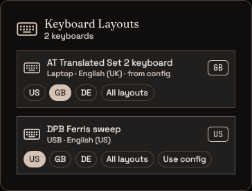
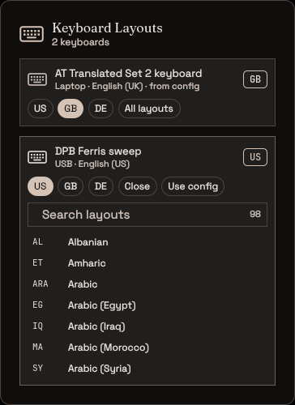

# Keyboard Layouts

A layout per keyboard. Plug in a USB keyboard and pick its layout, or the laptop
keyboard's, from the QS Bar, so a US external board and a UK laptop keyboard each type what is printed
on their keys. The choice is remembered and applied again every time that
keyboard is plugged in.






## Use

The bar shows a keyboard icon and the layout of the keyboard you are typing on (US,
GB, DE...). It is tinted in the accent while a plugged-in keyboard has a layout
chosen here.

Click it to open the panel. Each keyboard (every USB keyboard, plus the laptop's
own) gets a card with its name, how it is connected, and its current layout. Then:

- click a **quick layout** chip (`us`, `gb` by default) to switch that keyboard;
- **All layouts** opens a searchable list of every xkb layout on the system
  (type to filter, Enter picks the first match, Esc closes it);
- **Use config** forgets the choice and reloads Hyprland, so the keyboard goes
  back to whatever your Hyprland config sets.

Only the keyboard you pick changes. The others keep their layouts.

## Settings

QS Bar Settings > Community > Keyboard Layouts:

| key              | type   | default | description                              |
| ---------------- | ------ | ------- | ---------------------------------------- |
| pinned           | text   | `us,gb` | Quick layouts, comma-separated xkb codes |
| includeBluetooth | toggle | false   | Also list Bluetooth keyboards            |
| includeBuiltin   | toggle | true    | List the laptop (built-in) keyboard      |
| poll             | int    | 3       | Check for keyboards every N seconds      |

## How it works

A keyboard is a device in `/proc/bus/input/devices` with letter keys (so a
keyboard's separate media-key and power-button nodes are skipped), joined by
name with `hyprctl -j devices`. USB devices are bus `0003`, Bluetooth `0005`,
and everything else counts as the laptop keyboard.

Picking a layout runs

```
hyprctl eval 'hl.device({ name = "<keyboard>", kb_layout = "<code>", kb_variant = "" })'
```

which changes only that keyboard, live. Keyboard names and layout codes are
checked against strict patterns first, so nothing from a device name or a
setting can reach the Lua string unescaped. Every few seconds, and right after
a Hyprland config reload, the plugin checks whether each saved keyboard is
present with a different layout and applies the choice again. That covers
replugging, `hyprctl reload`, and a shell restart. A layout that does not take
is not retried until the keyboard is replugged or the config reloads.

Needs Hyprland with the Lua config (`hyprctl eval`), as Ryoku ships.

## What it runs, reads and writes

- **Runs** `hyprctl -j devices`, `hyprctl eval` (only the `hl.device` call
  above), `hyprctl reload` (only on **Use config**), `cat` and `mkdir -p`,
  always with argv arrays.
- **Reads** `/proc/bus/input/devices` and `/usr/share/X11/xkb/rules/evdev.lst`
  (the layout names).
- **Writes** only `$XDG_STATE_HOME/ryoku/plugins/kbd-layouts/assignments.json`:
  keyboard name to layout code. It never edits your Hyprland config files.
- No network, no privileged commands.

## Install

From Ryostore, or from a checkout:

```
ryoku plugin validate .
ryoku plugin add . --bar --yes
```

## Author

Madhav Khosla <madhav.khoslaa@gmail.com>. Community plugin (`official` is
false). MIT licensed.
