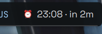

# SayAlarm bar widget

Next SayAlarm on the Ryoku bar: `⏰ 07:30 · in 3h 12m`. Clicking the glyph
opens a panel with the note, the countdown, an OPEN APP button and REFRESH.



## What it does

- Shows the next enabled SayAlarm and updates its countdown every 30 seconds.
- Opens a panel with the alarm note, an immediate refresh action and an action
  to launch SayAlarm.
- Can hide the countdown through the plugin setting.

## Install

Install this widget from Ryostore, then add SayAlarm under QS Bar Settings >
Community.

This is a companion widget and needs the
[SayAlarm desktop app](https://github.com/KingsMill8/sayAlarm). Keep its source
checkout in `~/sayAlarm`, `~/sayalarm`, `~/Projects/sayAlarm` or
`~/Projects/sayalarm`, or set `SAYALARM_DIR` to its location in the Ryoku shell
environment. The widget does not install the app.

Without the desktop app or its alarm store, the widget stays available and
shows `no alarms`; the OPEN APP action exits without launching anything.

## How it plugs in

- `service/Main.qml` polls the read-only helper every 30 seconds and exposes the
  next alarm to the glyph and panel.
- `content/Widget.qml` is the `topbarGlyph` view.
- `content/Panel.qml` shows the alarm details and explicit actions.

## What it runs, reads and writes

- **Runs**: `bin/next-alarm` through its Python 3 shebang every 30 seconds. It
  imports the local SayAlarm checkout's `alarm_lib` module to use the app's
  scheduling logic. `bin/open-sayalarm` runs only after an explicit OPEN APP
  click and launches that local checkout with Python 3.
- **Reads**: `~/.local/share/sayalarm/alarms.json`, the local SayAlarm source
  checkout's `alarm_lib`, `SAYALARM_DIR`, and its own `pluginSettings`.
- **Writes**: nothing. It has no state files, network access, privileged
  actions, secrets or compiled binaries.

Both helpers pass arguments as arrays or separate shell arguments. They do not
contact the network or download code.

## Settings

| Key | Default | Meaning |
| --- | --- | --- |
| `showCountdown` | on | Show the live countdown next to the alarm time |

## Develop

```text
sayalarm/
  manifest.json
  service/Main.qml
  content/Widget.qml
  content/Panel.qml
  bin/next-alarm
  bin/open-sayalarm
  assets/preview-widget.png
```

## Credits

Created by KingsMill8. The widget is MIT-licensed; the companion SayAlarm
application is AGPL-3.0 licensed.
